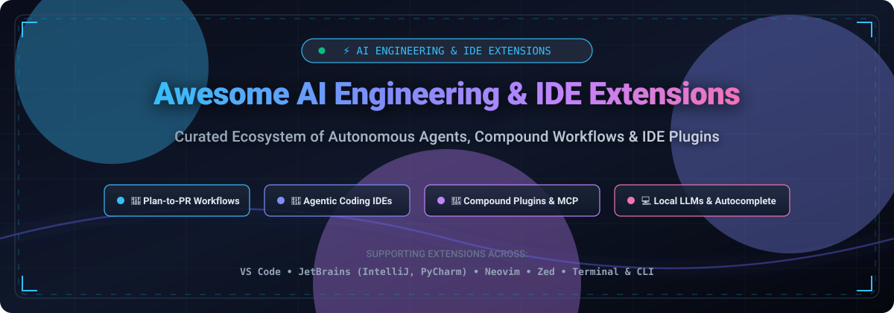

# 🚀 Awesome AI Engineering Workflow & IDE Extensions Ecosystem

  

  
  
  
  
  
  

---

## ⚡ Overview & Ecosystem Focus

A curated directory of top-tier **SaaS products** and active **open-source GitHub projects** powering the next era of **AI Engineering Workflows & IDE Extensions**. 

From autonomous coding agents (`Cursor`, `Cline`, `Roo Code`, `OpenHands`) and plan-to-PR pipelines (`Copilot Workspace`, `Aider`, `BMAD-METHOD`) to compound engineering skills and local LLM autocomplete engines (`Continue`, `Tabby`, `Twinny`, `Zed`), this guide delivers the most complete, factual, and actionable index for modern software engineers, tech leads, and autonomous AI developers.

> 📅 **Last Curated & Verified**: November 2026

---

## 📑 Table of Contents

- [📊 Sector Overview & Market Dynamics](#-sector-overview--market-dynamics)
- [🏢 SaaS & Hosted Commercial Platforms](#-saas--hosted-commercial-platforms)
- [🌐 Open-Source GitHub Projects](#-open-source-github-projects)
- [🤝 How to Contribute](#-how-to-contribute)
- [💖 Support](#-support)
- [⭐ Star History](#-star-history)
- [📜 Disclaimer](#-disclaimer)

---

## 📊 Sector Overview & Market Dynamics

The AI developer tooling and engineering workflow software market is projected to reach **$7.0B to $9.5B by 2026**, driven by an aggressive enterprise shift from single-line autocomplete toward multi-file agentic architectures, automated test suites, and plan-to-PR synthesis.

The sector demonstrates a **concentrated core** anchored by tech hyperscalers and dominant category leaders (including Microsoft/GitHub, Amazon, and Anysphere/Cursor) who capture the majority of commercial enterprise budgets. In parallel, a **moderately fragmented and rapidly expanding frontier** of open-source projects, community agent protocols (such as Model Context Protocol - MCP), and specialized IDE forks continually challenge incumbents with localized, privacy-first, and highly configurable workflows.

---

## 🏢 SaaS & Hosted Commercial Platforms

*Enterprise and hosted AI coding platforms sorted in descending order by company valuation / market capitalization.*

| Platform | Company Valuation / Revenue | Starting Tier Pricing | Free Tier Limits / Evaluation | Description |
| :--- | :--- | :--- | :--- | :--- |
| **[Amazon Q Developer](https://amazon.com)** | ~$2.1T (Parent: Amazon Market Cap) / $19/user/mo Pro tier | $19.00 / user / month (Pro Tier) | **Perpetual Free Tier**: 50 agentic requests/mo, 1,000 lines of code transformation/mo, and 50 security scans/mo (AWS Builder ID required). | Cloud AI software development assistant providing IDE code generation, automated Java/Python runtime upgrades, security vulnerability scanning, and AWS infrastructure troubleshooting. |
| **[GitHub Copilot & Copilot Workspace](https://github.com)** | ~$3.1T (Parent: Microsoft Market Cap) / ~$2B+ Copilot ARR | $10.00 / month (Copilot Pro) | **Perpetual Free Tier**: 2,000 code completions/mo and 50 chat messages/mo with basic agent capabilities; 30-day trial for Pro. | End-to-end AI engineering platform spanning inline IDE autocomplete, multi-file Copilot Edits, issue-to-PR planning workspaces, and autonomous coding agent workflows. |
| **[Cursor](https://cursor.com)** | $60B (Acquired by SpaceX, Aug 2026; prev. $29.3B Series D) | $20.00 / month (Pro Tier) | **Perpetual Free Tier (Hobby)**: 2,000 Tab completions/mo and 50 slow premium requests/mo; 14-day Pro trial on signup. | AI-native code editor forked from VS Code featuring predictive Tab autocomplete, codebase-wide RAG indexing, Composer multi-file agents, and background cloud agents. |
| **[Replit Agent & Ghostwriter](https://replit.com)** | $9B (Series D, Mar 2026; prev. $3B valuation) | $25.00 / month (Replit Core) | **Perpetual Free Tier (Starter)**: 0.5 vCPU, 512MB RAM, limited basic autocomplete, and a restricted daily allowance for Replit Agent. | Cloud-based collaborative IDE and autonomous software engineering platform capable of planning, coding, debugging, and deploying full-stack applications from natural language. |
| **[Windsurf (formerly Codeium)](https://windsurf.com)** | $3B (Acquired via Google licensing & Cognition, 2025) | $15.00 / month (Codeium Pro) / $20.00 / month (Windsurf Pro) | **Perpetual Free Tier**: Unlimited standard code autocompletions/edits across IDEs, with a restricted light quota for Cascade Flow agent actions on mini models. | Agentic AI IDE and multi-editor extension suite powered by Cascade flows, deep contextual awareness, live terminal/preview synchronization, and low-latency Supercomplete. |
| **[Sourcegraph Cody](https://sourcegraph.com)** | $2.6B (Series D valuation) / ~$50M ARR | $19.00 / user / month (Enterprise Starter) | **Enterprise Trial**: No perpetual free individual tier; provides a customized 14-to-30 day Enterprise proof-of-concept (PoC) evaluation upon sales demo. | Enterprise AI engineering assistant leveraging Sourcegraph's code graph and multi-repository search to deliver context-aware chat, inline edits, and unit test synthesis. |
| **[Augment Code](https://augmentcode.com)** | $977M (Series B valuation) | $20.00 / user / month (Standard Plan) | **Free Evaluation**: No perpetual free tier; offers an initial 7-day free trial / trial credits upon workspace onboarding. | Enterprise AI software engineering platform engineered with real-time codebase context engines for massive monorepos and autonomous task execution. |
| **[JetBrains AI Assistant & Junie](https://jetbrains.com)** | ~$700M+ Annual Revenue (Privately held / bootstrapped) | $10.00 / month (AI Pro) | **Perpetual Free Tier (`AI Free`)**: Unlimited local model support, basic local completions, and 3 cloud AI credits/30 days; includes 30-day AI Pro trial. | Natively integrated AI coding assistant and autonomous engineering agent built directly into IntelliJ IDEA, PyCharm, WebStorm, GoLand, and Rider. |
| **[Tabnine Enterprise](https://tabnine.com)** | ~$100M (Acquired by Tricentis, Jul 2026) / ~$27M ARR | $39.00 / user / month (Code Assistant Plan) | **Free Trial**: 90-day free trial of Pro/Code Assistant features; perpetual free starter tier has been discontinued. | Enterprise-grade AI coding assistant emphasizing zero-data-retention privacy, VPC/air-gapped deployments, custom repository fine-tuning, and compliance-safe code generation. |
| **[Continue.dev Hub (Cloud)](https://continue.dev)** | $5.5M funding raised (Acquired by Cursor, Jun 2026) | $10.00 / developer / month (Team Hub) | **Perpetual Free Tier**: Full open-source client extension (Apache 2.0) with unlimited usage via local LLMs (Ollama) or Bring-Your-Own-Key (BYOK). | Cloud governance and configuration layer for the open-source Continue IDE extension enabling shared team engineering assistants, MCP tool setups, and model routing policies. |

---

## 🌐 Open-Source GitHub Projects

*Open-source AI coding tools, autonomous agents, and IDE plugins sorted in descending order by GitHub star count.*

1. **[Superpowers (`obra/superpowers`)](https://github.com/obra/superpowers)**   
   Structured software engineering skill framework for Claude Code, Codex, and OpenCode enforcing brainstorming, test-driven development (TDD), subagent orchestration, and systematic debugging workflows.

2. **[OpenCode (`anomalyco/opencode`)](https://github.com/anomalyco/opencode)**   
   Modern, open-source terminal-native AI coding agent featuring a slick TUI, Language Server Protocol (LSP) diagnostics integration, client/server architecture, and multi-provider LLM support.

3. **[Zed Editor (`zed-industries/zed`)](https://github.com/zed-industries/zed)**   
   High-performance, GPU-accelerated Rust code editor with built-in Agentic Editing, multi-buffer AI workflows, and real-time Edit Prediction using open Zeta models.

4. **[OpenHands (`OpenHands/OpenHands`)](https://github.com/OpenHands/OpenHands)**   
   Autonomous AI software engineering platform executing complex code tasks inside sandboxed Docker containers with full shell, editor, browser, and GitHub issue-to-PR capabilities.

5. **[Cline (`cline/cline`)](https://github.com/cline/cline)**   
   Autonomous AI engineering agent for VS Code with human-in-the-loop approval, capable of creating and editing multi-file projects, executing terminal commands, viewing browsers, and calling custom MCP tools.

6. **[BMAD-METHOD (`bmad-code-org/BMAD-METHOD`)](https://github.com/bmad-code-org/BMAD-METHOD)**   
   Open-source specification-driven engineering workflow (`Specify -> Plan -> Tasks -> Implement`) designed to structure autonomous agents across VS Code, Cursor, and terminal environments.

7. **[GPT-Engineer (`AntonOsika/gpt-engineer`)](https://github.com/AntonOsika/gpt-engineer)**   
   Command-line tool and agent framework that builds complete codebases from user prompts, handles iterative refinements, and synchronizes code changes into IDE workspaces.

8. **[Aider (`Aider-AI/aider`)](https://github.com/Aider-AI/aider)**   
   Terminal AI pair-programming assistant that maps Git repositories, executes coordinated multi-file edits, runs linters and test suites, and creates atomic Git commits automatically.

9. **[CopilotKit (`CopilotKit/CopilotKit`)](https://github.com/CopilotKit/CopilotKit)**   
   Open-source framework to build custom in-app AI copilots, AI textareas, and generative IDE UI components with agent-state synchronization and MCP integrations.

10. **[Khoj (`khoj-ai/khoj`)](https://github.com/khoj-ai/khoj)**   
    Open-source AI copilot and personal search engine for software engineers with native plugins for Emacs, Obsidian, Desktop, and web for building a searchable second brain across repos and docs.

11. **[Continue (`continuedev/continue`)](https://github.com/continuedev/continue)**   
    Leading open-source AI code assistant extension for VS Code and JetBrains enabling custom Tab autocomplete, inline diff editing, and agentic workflows backed by any local or cloud LLM.

12. **[Tabby (`TabbyML/tabby`)](https://github.com/TabbyML/tabby)**   
    Self-hosted AI coding assistant written in Rust with repository-level RAG, Fill-in-the-Middle (FIM) autocomplete, and client extensions for VS Code, IntelliJ, and Vim/Neovim.

13. **[GPT-Pilot (`Pythagora-io/gpt-pilot`)](https://github.com/Pythagora-io/gpt-pilot)**   
    Real-world AI pair programmer that writes production-ready apps step-by-step alongside the developer, debugging code, running tests, and requesting user feedback.

14. **[Void (`voideditor/void`)](https://github.com/voideditor/void)**   
    Open-source AI-native code editor built directly on VS Code providing inline diffs, codebase indexing, agentic file modifications, and local Ollama or BYOK LLM connectivity.

15. **[Kilo Code (`Kilo-Org/kilocode`)](https://github.com/Kilo-Org/kilocode)**   
    Unified open-source VS Code AI engineering extension combining capabilities from Cline, Roo Code, and Continue with intelligent multi-model routing and automated refactoring.

16. **[Compound Engineering Plugin (`EveryInc/compound-engineering-plugin`)](https://github.com/EveryInc/compound-engineering-plugin)**   
    Structured compound software engineering plugin for Claude Code, Cursor, OpenCode, and Codex delivering formal `/workflows:plan`, `/workflows:work`, `/workflows:review`, and `/workflows:compound` cycles.

17. **[Roo Code (`RooCodeInc/Roo-Code`)](https://github.com/RooCodeInc/Roo-Code)**   
    Feature-rich open-source fork of Cline offering specialized engineering modes (`Architect`, `Code`, `Debug`, `Orchestrator`), Boomerang sub-tasks, and granular model routing.

18. **[Avante.nvim (`avante-corp/avante.nvim`)](https://github.com/avante-corp/avante.nvim)**   
    Open-source Neovim plugin emulating the Cursor AI IDE experience inside terminal Neovim, featuring side-by-side diff previews, agentic tool execution, and multi-model support.

19. **[PR-Agent (`The-PR-Agent/pr-agent`)](https://github.com/The-PR-Agent/pr-agent)**   
    AI-powered pull request reviewer and engineering workflow tool providing automated code walkthroughs, bug detection, test suite generation, and interactive `/improve` PR commands.

20. **[Plandex (`plandex-ai/plandex`)](https://github.com/plandex-ai/plandex)**   
    Terminal-based AI coding engine designed for complex software tasks that span dozens of files, utilizing sandbox execution, version control integration, and diff reviews.

21. **[Sweep (`sweepai/sweep`)](https://github.com/sweepai/sweep)**   
    Open-source AI junior developer that turns GitHub issues into tested pull requests, reading entire codebases, creating branches, writing code, and iterating on reviews.

22. **[CodeCompanion.nvim (`olimorris/codecompanion.nvim`)](https://github.com/olimorris/codecompanion.nvim)**   
    Extensible AI engineering plugin for Neovim supporting inline code transformations, agentic slash commands, Model Context Protocol (MCP) servers, and local/cloud LLM adapters.

23. **[Twinny (`twinnydotdev/twinny`)](https://github.com/twinnydotdev/twinny)**   
    Privacy-first VS Code extension built specifically for local Ollama, llama.cpp, and LM Studio inference featuring zero telemetry, FIM code completion, and codebase RAG chat.

24. **[Refact.ai (`smallcloudai/refact`)](https://github.com/smallcloudai/refact)**   
    Self-hostable AI coding engine supporting custom local fine-tuning, AST-aware code completions, and autonomous bug-fixing agents for VS Code and JetBrains IDEs.

25. **[Minuet AI (`milanglacier/minuet-ai.nvim`)](https://github.com/milanglacier/minuet-ai.nvim)**   
    Ultra-lightweight Neovim plugin for dance-like code completion powered by Claude 3.5, OpenAI, Codestral, or local Ollama LLMs with virtual text ghost completions.

---

## 🤝 How to Contribute

Contributions are warmly welcome! Whether you are an open-source maintainer or an active user of an AI extension:

1. **Fork** this repository.
2. Create your branch: `git checkout -b feat/add-awesome-extension`.
3. Add or update the platform/project under the relevant section:
   - Ensure the name, repository link, and description are factual.
   - For SaaS products, verify starting prices and free tier limits.
   - For open-source repos, include the social star badge linking to the stargazer page.
4. **Commit** your changes: `git commit -m "Add new AI engineering extension"`.
5. **Push** to your fork: `git push origin feat/add-awesome-extension`.
6. Open a **Pull Request** detailing why the tool belongs in this curated ecosystem.

---

## 💖 Support

Thank you for exploring this ecosystem! If you find this directory helpful for your engineering workflow:

- ⭐ **Star this repository** to help other developers discover it!
- 🍴 **Fork and share** with your software engineering team or community.
- ☕ **Buy me a coffee**: If you'd like to support ongoing curation and maintenance, consider sponsoring via the [GitHub Sponsors Dashboard](https://github.com/sponsors/ishandutta2007).

---

## ⭐ Star History

---

## 📜 Disclaimer

*This repository is curated for educational, developmental, and research purposes. Product names, logos, and brands are property of their respective owners. Pricing, tier limits, valuations, and star counts are subject to change over time.*
